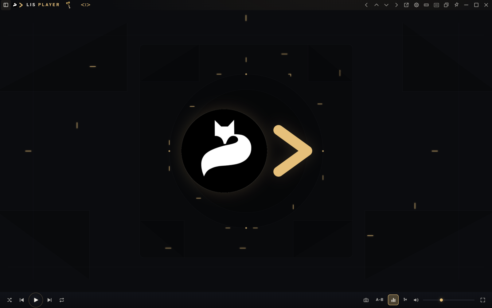

# LIS PLAYER

Проигрыватель. Аудио, видео, картинки и документы с диска. Файлы никуда не отправляются.

Текущая версия **1.0.1**.

- [Windows](https://github.com/lis-creative-suite/lis-player-1.0/releases/download/v1.0.1/LIS-PLAYER-Setup-1.0.1.exe)
- [Android](https://github.com/lis-creative-suite/lis-player-1.0/releases/download/v1.0.1/LIS-PLAYER-1.0.1.apk)
- [Все версии](https://github.com/lis-creative-suite/lis-player-1.0/releases)

---

## Установка

При установке четыре галочки форматов и одна — нейросети.

- **Аудио**, **Видео**, **Изображения**, **Документы** — эти файлы становятся форматами по умолчанию и открываются двойным щелчком в плеере. Снятая галочка не запрещает открыть файл вручную. Позже набор включается в настройках: «Назначить ассоциации».
- **Нейроверсия** — выключена по умолчанию и ничего не скачивает. Это бета. Включается потом, в настройках, отдельными кнопками.

Программа ставится для текущего пользователя. Если Windows показывает «Защитила компьютер», это проверка скачанного файла, а не сбой установщика. Без сертификата издателя такое окно у Windows бывает: «Подробнее», затем «Выполнить в любом случае».

Уже установленную копию можно обновить на месте. Папка медиатеки и сами файлы при этом не удаляются.

На рабочем столе и в меню Пуск появляется ярлык. Значок — лиса.

Рядом с программой лежит `lis-sort.ps1`. Это раскладка папки без нейросети: Audio, Video, Images, Documents. По умолчанию файлы копируются. Перенос: `-Mode move`.

---

## Обновление

При следующем запуске, если вышла новая версия, в шапке появляется метка. Окно можно не закрывать и продолжать смотреть или слушать.

- **Обновить** — поставить новую версию.
- **Не сейчас** — скрыть эту версию. Плеер работает как прежде.

Установленные копии получают обновление при следующем запуске и переходят на текущую версию.

---

## Как открывается файл

Двойной щелчок в проводнике открывает файл сразу, без пустого окна и без прошлой сессии.

Окно, если включено «окно следует за кадром», строится под размер картинки или видео. Песня с холодного запуска открывается узкой полосой внизу экрана. Видео, картинка и документ открываются большим окном.

У каждого вида запоминается своё: рамка, прикрепление к краю, список, мини-полоса или большое окно. Запоминается вид, а не прошлый файл.

Пока плеер уже открыт, следующий файл приходит в то же окно сразу.

---

## Окно

Одно окно: шапка, сцена, нижняя панель. Системной рамки нет.

| Вид | Как |
|---|---|
| Список | кнопка слева в шапке |
| Мини-полоса | кнопка компакта или двойной щелчок по шапке. Для песни это вид по умолчанию, пока плеер был закрыт |
| Без рамки | кнопка «Без рамки». Шапка показывается у верхнего края |
| Край экрана | стрелки в шапке |
| Кинозал | двойной щелчок по кадру или клавиша `F` |
| Окно по кадру | кнопка в шапке. Широкое, высокое и повёрнутое фото получают своё окно |

Видео само в мини-полосу не уходит. Если мини-полосу включили вручную, она держится, пока плеер не закрыт.

На картинке и видео шкала перемотки становится выше, когда на неё наводят курсор.

У видео с несколькими звуковыми дорожками кнопка у громкости: один щелчок переключает дорожку, удержание открывает список. Одна дорожка — оранжевая кнопка, несколько — зелёная.

Документы Word, PDF и страницы HTML открываются как документ, не как плеер пустого кадра.

---

## Медиатека

Папка **LIS_Player_Library**: полки Audio, Video, Images, Documents. Скриншоты лежат в Images\Screenshots.

По умолчанию файл в библиотеку копируется, исходник остаётся на месте. Постоянный режим в настройках переносит файл.

Папку можно отдать на раскладку без нейросети: правила смотрят расширение, имя и дату. То же делает `lis-sort.ps1`.

Нейросеть к раскладке не обязательна и сама не включается.

В корне медиатеки лежит паспорт `lis-player-library.json`. По нему другие программы узнают полки и где лежит Creative Suite. Удалять его не нужно: плеер создаст его снова.

Полка **Creative Suite** пока «скоро». Её место уже выделено: папка `Creative Suite` с индексом `lis-library.json` и папками VLOG, AI Designer, LisKino, Maestro, Note-Pro, Praxis, Suite, Other. Это формат библиотеки LIS CREATIVE SUITE, поэтому сюит сможет открыть эту папку как свою. Плеер индекс только читает и не переписывает.

---

## Android

[LIS-PLAYER-1.0.1.apk](https://github.com/lis-creative-suite/lis-player-1.0/releases/download/v1.0.1/LIS-PLAYER-1.0.1.apk), Android 10 и новее. При первой установке телефон спросит разрешение ставить приложения из этого источника.

Вкладки: аудио, видео, фото, документы, библиотека. Окно заходит под верхнюю челку. Музыка играет с выключенным экраном, в шторке есть пауза, предыдущий и следующий.

В видео кнопка поворота. У левого края — яркость, у правого — звук, по горизонтали — перемотка. Долгое нажатие открывает скорость, повтор, вписать или заполнить кадр и таймер. Фото листаются свайпом, двойной тап увеличивает. PDF открывается постранично.

Долгое нажатие на файл: «В библиотеку», «Поделиться», «Открыть в другом приложении». «В библиотеку» копирует файл в `Documents/LIS_Player_Library` на телефоне, по тем же полкам, что на компьютере.

Документы, которые положили другие программы, видны после кнопки «Показать все документы телефона».

---

## Нейро, бета

Это опытная часть. Ею можно пользоваться, на скорость открытия файлов она не опирается.

В настройках, блок «Нейро»:

1. Плеер смотрит компьютер: память, процессор, видеокарту, свободное место.
2. **Без нейро** — только правила. Это обычный режим.
3. **Гермес** — если Гермес уже стоит на этом компьютере, плеер отдаёт ему навык открывать файлы и смотреть медиатеку. Чужие ключи и SSH плеер не копирует.
4. **Ollama** — если локальная Ollama запущена, в списке видны её модели. Пока она не запущена, список пуст.
5. **Скачать простую модель** — отдельное нажатие. Небольшой пакет встаёт в данные плеера и работает на процессоре. Большая модель предлагается только если хватает памяти или видеопамяти. Скачивание не начинается само.

Видеокарта читается и у NVIDIA, и через данные Windows, если карта другая. Сначала выбирается лёгкий путь. Тяжёлая модель не ставится на слабую машину.

---

## Настройки, которые остаются

Тема, громкость, клавиши, папка библиотеки, лимит скриншотов, редакторы LIS Tone, Grade, Cutter и Docs. Кнопка EDIT открывает редактор LIS. Свою программу можно назначить на клавишу редактора.

Форматы, снятые при установке, включаются там же, где ассоциации. После этого они открываются так же быстро.

---

## Клавиши

Пробел — пуск и пауза. Стрелки влево и вправо — предыдущий и следующий. Вверх и вниз — громкость. `F` — кинозал. Esc прячет плеер в трей, Shift+Esc возвращает его. Свои клавиши задаются в настройках.
